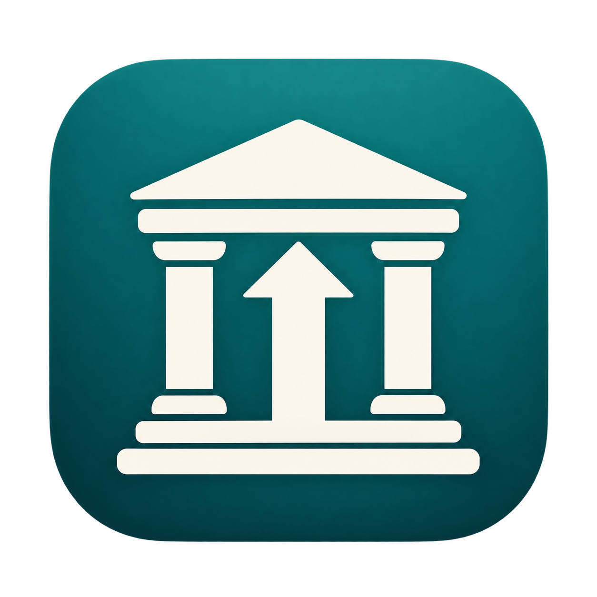

# Internet Archive 上传器：桌面界面 + 命令行

<p align="center"></p>

[下载 macOS Apple Silicon 安装包（v0.1.1）](https://github.com/redoop/ia-uploader/releases/tag/v0.1.1) · [所有版本](https://github.com/redoop/ia-uploader/releases)

Rust 编写的 Internet Archive 上传软件，同时提供原生桌面界面和命令行入口，共用认证、上传、重试逻辑。通过 S3 API Key 验证账号，然后以固定内存流式上传大文件。支持中文文件名/标题、多个文件顺序上传、发送进度与速率、网络错误及 HTTP 429/5xx 指数退避重试、307/308 重定向重新打开文件发送。凭据只发送到 HTTPS archive.org 或其子域，不写入磁盘或日志。

## 编译

安装 Rust 1.92 或更新版本，在本目录运行：

```sh
cargo build --release --locked
```

生成两个程序（Windows 为 `.exe`）：

- `target/release/ia-uploader`：桌面窗口。
- `target/release/ia-upload-cli`：命令行工具。

仅需命令行时，可跳过全部界面依赖：`cargo build --release --locked --no-default-features --bin ia-upload-cli`。

## 桌面界面

运行 `cargo run --bin ia-uploader` 或双击打包后的应用。macOS 可运行 `sh scripts/package-macos.sh`，生成 `dist/Internet Archive Uploader.app`。

1. 在界面填写 Access Key、Secret Key，点击“验证账号”。密钥不落盘。
2. 填写 Identifier（归档唯一标识），可选填写中文标题、Collection 和媒体类型。
3. 点击“添加文件”多选本地文件，或拖放到窗口；支持移除和清空。
4. 点击“开始上传”，查看当前文件、发送进度、速率和已完成数量。
5. 取消按钮发出取消请求；读文件和重试等待会响应取消。正在连接、等待服务器响应的请求需等网络操作返回后才结束，不能保证即时取消。

网络操作在后台线程运行，不阻塞窗口。运行期间锁定输入，防止凭据与队列中途变化。当前进度是当前文件的发送进度，100% 后仍需等待服务器确认。归档通常公开可读；同名远端文件会替换并保留旧版本。关闭窗口会终止当前任务。

中文显示使用系统字体：macOS STHeiti、Windows 微软雅黑、Linux Noto Sans CJK（Linux 需安装字体和桌面运行库）。本次仅在 macOS 构建和测试。

## 验证账号

登录 https://archive.org/account/s3.php 获取 **Internet Archive** 的 Access Key 和 Secret Key（不是 AWS 凭据，也不是网站密码）。在终端中设置环境变量。macOS 的 zsh 可使用隐藏输入，避免把密钥写入命令历史：

```zsh
read -rs 'IA_ACCESS_KEY?Access Key: '; echo
read -rs 'IA_SECRET_KEY?Secret Key: '; echo
export IA_ACCESS_KEY IA_SECRET_KEY
./target/release/ia-upload-cli auth
```

程序调用 `https://s3.us.archive.org/?check_auth=1` 验证凭据，每次上传前也会验证。错误会以非零状态退出。不需要在聊天中提供密钥。

## 上传大文件

```sh
./target/release/ia-upload-cli upload my-archive-20261023 \
  /absolute/path/backup.7z \
  --title '我的备份' --collection opensource --mediatype data
```

多个文件直接追加路径；远端名称使用文件基本名称，队列内禁止重名：

```sh
./target/release/ia-upload-cli upload my-video-20261023 \
  /absolute/path/part1.mp4 /absolute/path/part2.mp4 \
  --title '视频资料' --collection opensource_movies --mediatype movies \
  --retries 5 --no-derive
```

`identifier` 是详情页 `/details/<identifier>` 的唯一标识，新建时请选择未占用的名称；上传已有 item 时须拥有写入权限。新建时的 title、collection、mediatype 经请求头提交；已有 item 的元数据不会据此修改。collection 必须允许你的账号上传。

同名远端文件会被替换，请检查 identifier 和文件名。请求设置 `x-archive-keep-old-version:1` 让服务端保存旧版本。

## 大文件行为与限制

- 文件通过 `Read` 流发送，使用 64 位大小和 Content-Length，不会整文件加载内存；大小上限由 IA 服务端、账号权限和存储资源决定。
- 当前使用单次 PUT。失败重试从当前文件开头发送，**不支持分片或字节级断点续传**；重新运行也会重传列出的文件。
- 建连超时 30 秒，账号验证超时 60 秒。上传没有总时间限制，适合多小时传输；遇到长期停滞可按 Ctrl+C 终止并重新运行。
- 默认最多额外重试 3 次，最多可配置 10 次。401/403 等永久错误立即退出；429/5xx 与网络故障退避重试。
- 进度代表客户端读取并发送的字节，不代表服务端已永久入库；只在成功 HTTP 响应后报告已接受。最终归档和派生处理可能延迟。
- 上传期间不要修改源文件。程序会在每次发送前检查大小及修改时间；没有额外的服务端回读校验。
- 凭据有效不代表有权写入所有 item 或 collection。上传内容通常公开可读。

## 验证

```sh
cargo test --locked
cargo clippy --all-targets --locked -- -D warnings
cargo fmt --check
```

自动测试覆盖重定向凭据边界、Unicode 元数据/路径编码、identifier 校验、认证拒绝、307 重定向完整重放、503/断线重试、429 重试耗尽、403 不重试、5 GiB 稀疏文件读取与取消、GUI 队列去重及错误解锁。HTTP 测试在本地回环地址使用虚拟凭据，不会向 Internet Archive 写入数据。真实账号验证和上传需要自行设置凭据并联网执行。

## 接口参考

- [IA 官方 S3 接口](https://archive.org/developers/ias3.html)：LOW 认证、PUT、重定向、元数据、size hint、旧版本。
- [IA 官方凭据入口](https://archive.org/account/s3.php)。

## 连接超时与代理

程序默认读取 macOS / Windows 系统代理及 HTTP_PROXY、HTTPS_PROXY 等环境变量。macOS 的 ClashX 系统代理可以直接使用，无需从终端启动桌面程序。

界面提供三种连接方式：

- 自动代理：使用系统或环境变量代理，默认选项。
- 直连：忽略所有代理。
- 手动代理：指定 `http://127.0.0.1:7890` 或 `socks5h://127.0.0.1:7890` 等地址；以代理软件实际配置为准。

命令行可在子命令前后使用全局参数：

```sh
./target/release/ia-upload-cli auth --proxy http://127.0.0.1:7890
./target/release/ia-upload-cli upload my-archive-20261023 /path/file.zip --proxy http://127.0.0.1:7890
./target/release/ia-upload-cli auth --direct
```

`--proxy` 与 `--direct` 不能同时使用。手动代理不修改系统设置，不保存到磁盘；正常 HTTPS 证书校验保持开启。连接超时表示没有拿到服务器的认证结果，不表示密钥无效。升级后请关闭旧进程并打开 `dist/Internet Archive Uploader.app`，之前已经打开的预览窗口不会自动更新。

## DMG 安装包

在 macOS 执行 `sh scripts/package-dmg.sh`，会重新构建应用并生成当前本机架构的压缩 DMG、SHA-256 校验文件。安装镜像包含桌面应用、指向 Applications 的拖拽安装入口、命令行工具及中文说明。双击 DMG，将应用拖入 Applications 后即可推出镜像。

当前产物：`dist/Internet-Archive-Uploader-0.1.1-macOS-arm64.dmg`，适用于 Apple Silicon Mac。镜像内应用使用本地临时签名，尚未进行 Apple 开发者签名及公证。

## 应用图标

0.1.1 版本使用新的档案馆与上传箭头 Logo。原始透明 PNG 位于 `assets/logo-v1.png`，生成说明位于 `assets/logo-prompt.txt`，由内置 imagegen 生成。`scripts/build-icon.sh` 使用 macOS 工具生成多尺寸 `assets/AppIcon.icns`；打包脚本将其加入应用资源并设置 CFBundleIconFile。桌面程序同时内嵌 PNG 作为运行时图标。

DMG 也使用同一 Logo：镜像内部包含 `.VolumeIcon.icns`，挂载后的磁盘显示自定义图标；本地 DMG 文件通过 macOS 资源分支及 Finder 标记设置文件图标。传输工具若不保留 macOS 扩展属性，外部 DMG 文件图标可能恢复为默认样式，但镜像内部的磁盘图标不受影响。
